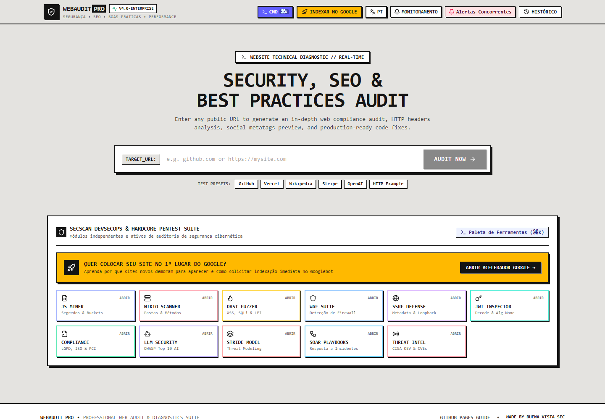

# WebAudit Pro

[](https://react.dev/)
[](https://www.typescriptlang.org/)
[](https://vitejs.dev/)
[](https://tailwindcss.com/)
[](LICENSE)

**WebAudit Pro** is an open-source website audit toolkit. Point it at a URL and it checks
**security headers, SEO, best practices, performance signals, accessibility and privacy**,
then explains every finding and gives you a copy-paste fix.

It is built to be **run by you, on your machine** — see [Philosophy](#philosophy-local-first-and-open-source).



---

## Table of contents

- [Philosophy: local-first and open source](#philosophy-local-first-and-open-source)
- [Run it locally](#run-it-locally)
- [Configuration](#configuration)
- [Features](#features)
- [What is measured vs. estimated](#what-is-measured-vs-estimated)
- [Security model](#security-model)
- [Self-hosting](#self-hosting)
- [Project structure](#project-structure)
- [Tech stack](#tech-stack)
- [Contributing](#contributing)
- [License](#license)

---

## Philosophy: local-first and open source

Website audits touch sensitive things: staging URLs, unreleased pages, client sites, security
weaknesses. We think the right default for that kind of tool is simple:

- **Run it yourself.** Clone the repo, run one command, and the full toolkit — backend included —
  runs on `localhost`. No account, no sign-up, no usage limits.
- **Your audits stay with you.** The server only talks to the sites *you* ask it to audit (and to
  Google Gemini, only if you add your own API key). Audit history, action plans and settings live
  in your browser's local storage. There is no telemetry and no central database.
- **Test before you trust.** Every check is plain TypeScript you can read. Run it against your own
  sites, compare it with other tools, and open an issue when something looks wrong.
- **No fake numbers.** When a value can't be measured (for example keyword search volume, which
  needs a paid data source), the tool says *not checked* instead of inventing one. Estimates are
  labeled as estimates — see [What is measured vs. estimated](#what-is-measured-vs-estimated).
- **Open source, open to change.** Fork it, adapt the rules to your team, add checks, and send
  them back.

### Hosted demo vs. full version

A hosted copy of the app is handy for a quick look, but a public demo has to be conservative:
anything that sends heavy or attack-like traffic to third-party sites is disabled, and some
features need the Node.js server to work at all (browsers cannot read another site's HTTP
headers). **For the complete toolkit, run it locally** with the steps below — it takes about a
minute.

---

## Run it locally

### Prerequisites

- **Node.js 20 LTS or newer** (Node 18 also works)
- **npm** (bundled with Node.js)
- Git

### 1. Clone and install

```bash
git clone https://github.com/saulofilho/webaudit.git
cd webaudit
npm install
```

### 2. (Optional) Configure environment variables

Everything works without configuration. To enable AI-written summaries and fix guides, or to
change defaults, copy the example file and edit it:

```bash
cp .env.example .env
```

See [Configuration](#configuration) for every option.

### 3. Start the development server

```bash
npm run dev
```

Open **http://localhost:3000**. The same process serves the React app (with hot reload) and the
API under `/api`. Use another port with `npm run dev -- --port 4000`.

### 4. Production build (optional)

```bash
npm run build
NODE_ENV=production npm start
```

`npm run build` bundles the frontend into `dist/` and the server into `dist/server.cjs`.
`NODE_ENV=production` makes the server serve the prebuilt files instead of starting Vite.

### Useful scripts

| Command | What it does |
| --- | --- |
| `npm run dev` | Development server with hot reload on port 3000 |
| `npm run build` | Production build of frontend and server |
| `npm start` | Runs the built server (`dist/server.cjs`); set `NODE_ENV=production` |
| `npm run lint` | Type-checks the whole project (`tsc --noEmit`) |

### Auditing sites on your own network

To protect hosted instances, the server refuses to fetch `localhost`, private IP ranges and cloud
metadata addresses. When you run the tool on your machine and want to audit a local dev server or
an intranet site, set this in `.env`:

```env
ALLOW_PRIVATE_TARGETS=true
```

Only do this on a machine that is not exposed to the internet.

---

## Configuration

All variables are optional. Defaults are safe for a public deployment.

| Variable | Default | Purpose |
| --- | --- | --- |
| `PORT` | `3000` | HTTP port (or pass `--port`) |
| `GEMINI_API_KEY` | – | Enables AI-generated executive summaries, SEO insights and fix guides. Without it, rule-based templates are used and labeled **Template · no AI** in the UI |
| `GEMINI_MODEL` | `gemini-3.8-flash` | Gemini model name |
| `ALLOW_PRIVATE_TARGETS` | `false` | Allow auditing `localhost` and private networks (local use only) |
| `ENABLE_ACTIVE_SCANS` | `false` | Enables the Nikto-style path probe and the DAST fuzzer, which send attack-like requests |
| `SECSCAN_TOKEN` | – | When set, active scans also require `Authorization: Bearer <token>` |
| `ADMIN_TOKEN` | – | Required to change the Google Search Console verification code through the API |
| `GOOGLE_SITE_VERIFICATION` | – | Google Search Console verification code served by the app |
| `TRUST_PROXY` | – | Number of reverse proxies in front of the app (e.g. `1`), so rate limiting sees real client IPs |

> **Active scans:** only enable them to test sites you own or are explicitly authorized to test.
> Probing other people's servers can violate the law and your hosting provider's terms.

---

## Features

### Core audit

- **Security headers:** HTTPS, HSTS, CSP, X-Frame-Options, X-Content-Type-Options,
  Referrer-Policy, Permissions-Policy and COOP, plus server banner / technology leakage.
- **SEO:** title and meta description length, H1 structure, canonical, robots, Open Graph,
  Twitter Cards, JSON-LD structured data, social profile links.
- **Best practices:** viewport, document language, charset, `target="_blank"` links without
  `rel="noopener"`.
- **Performance and accessibility:** response time (TTFB), HTML size, images without `alt`
  (empty `alt` is treated as decorative).
- **Technology detection:** servers, CDNs, CMSs and frontend frameworks.
- **Score and grade** per category, with a prioritized fix list and copy-paste snippets for
  Nginx, Apache, Node.js (Helmet), Next.js, Cloudflare and HTML.

### Site-level analysis

- **Broken links:** checks links on the page for 4xx/5xx, redirects and insecure targets.
- **Sitemap crawler:** reads `sitemap.xml` (including sitemap indexes) or the homepage links,
  then audits each page: status, title, H1, canonical, indexability, duplicate titles, internal
  link graph.
- **Keyword cannibalization:** finds pages competing for the same topic (duplicate or overlapping
  titles, shared anchor text), ignoring site-wide branding and translated pages.
- **Content gap:** compares your page with 1–3 competitor pages *you* choose: word count,
  headings, images and keywords they cover that you don't.
- **Image audit:** inventories images across pages, flags missing or low-quality `alt` text and
  suggests replacements.
- **Local SEO:** reads LocalBusiness schema, click-to-call links, Google Maps embeds, geo tags and
  opening hours from the page, with links to check directory listings manually.

### Security toolkit (SecScan)

- **Passive:** JavaScript bundle analysis (exposed keys, cloud bucket URLs, dangerous sinks), WAF
  detection, JWT inspector, SSRF / LLM / compliance checklists, STRIDE threat modeling and SOAR
  playbooks.
- **Threat intel:** the live CISA Known Exploited Vulnerabilities catalog (cached for 6 hours).
- **Active (opt-in):** sensitive path probes and a DAST fuzzer using harmless canary payloads.
  Disabled unless `ENABLE_ACTIVE_SCANS=true`.

### AI assistance (optional)

With `GEMINI_API_KEY` set: executive summary with executive or technical tone, SEO insights and
step-by-step fix guides tailored to your stack. Every AI panel shows whether the text came from
Gemini or from the built-in templates.

### Reporting and workflow

Action plan with progress tracking, audit history and trends, site comparison, SERP and social
card previews, JSON-LD and meta tag generators, sitemap generator, Markdown / JSON / CSV exports,
white-label print-to-PDF report and webhook test messages (Slack / Discord).

---

## What is measured vs. estimated

Honesty about data quality is a core rule of this project.

| Status | Features |
| --- | --- |
| **Measured** (fetched from the target site) | Core audit, headers, meta tags, links, sitemap crawl, cannibalization, content gap, images, local SEO on-page signals, JS bundle analysis, WAF detection, CISA KEV feed |
| **Estimated** (heuristics from measured data) | Core Web Vitals (from TTFB, HTML size and resources — not real browser metrics), internal PageRank / authority score, content score |
| **Simulated or manual** (no live data) | SSL certificate expiry and email DNS (SPF/DKIM/DMARC) panels, visual regression diff, scheduled monitoring and weekly competitor alerts (stored in your browser, nothing is sent automatically) |
| **Not checked** (needs a paid or private API) | Keyword search volume and difficulty, domain authority, Google Business Profile rating/reviews, directory citations |

If you can replace an estimate or simulation with real data, contributions are very welcome.

---

## Security model

The server fetches URLs on behalf of users, so it is hardened against abuse:

- **SSRF protection:** only `http`/`https` on standard web ports; DNS is resolved and checked at
  connect time, so `localhost`, private ranges, link-local/cloud metadata (`169.254.169.254`) and
  other reserved addresses are refused — including through redirects and DNS rebinding.
- **Rate limiting** per client IP on the API and stricter limits on security scans.
- **Response size and time limits** on every outbound request.
- **Active scans off by default** and optionally token-protected.
- **No secrets in the browser:** the Gemini key stays on the server.

Found a vulnerability? Please open a private security advisory on GitHub instead of a public issue.

---

## Self-hosting

Any host that runs Node.js works (Render, Railway, Fly.io, Google Cloud Run, a VPS, …):

```bash
npm ci
npm run build
NODE_ENV=production PORT=8080 npm start
```

Behind a reverse proxy or load balancer, set `TRUST_PROXY=1`. Keep `ENABLE_ACTIVE_SCANS`
disabled on any public instance.

---

## Project structure

```
├── server.ts                    # Express server: routes, security middleware, Vite / static serving
├── server/
│   ├── analyzer.ts              # Core audit engine and scoring
│   ├── techDetector.ts          # Server, CMS and framework detection
│   ├── extendedAudits.ts        # Broken links, sitemap crawl, internal link graph
│   ├── cannibalizationAudit.ts  # Keyword cannibalization clusters
│   ├── contentGapAudit.ts       # Competitor content comparison
│   ├── imageAudit.ts            # Image and alt-text audit
│   ├── localSeoAudit.ts         # Local SEO on-page signals
│   ├── sitemapUtils.ts          # Sitemap / sitemap index loader
│   ├── gemini*.ts               # Optional AI summaries, insights and fix guides
│   ├── secscan/                 # JS miner, WAF, threat intel, opt-in Nikto and DAST
│   └── security/
│       ├── safeFetch.ts         # SSRF-safe outbound HTTP client
│       └── apiGuards.ts         # URL validation, rate limiting, auth, error mapping
├── src/
│   ├── App.tsx                  # Main application shell
│   ├── components/              # Feature views and modals
│   ├── services/clientAnalyzer.ts  # Limited fallback audit when no server is available
│   ├── utils/htmlMeta.ts        # Shared HTML attribute / meta tag parser
│   ├── i18n/                    # UI translations
│   └── types.ts                 # Shared TypeScript types
└── .env.example                 # All configuration options
```

---

## Tech stack

- **Frontend:** React 19, TypeScript, Tailwind CSS v4, Vite 6, Recharts, Lucide icons, Motion
- **Backend:** Node.js, Express, `tsx` (development), esbuild (production bundle)
- **AI (optional):** Google Gemini via `@google/genai`

---

## Contributing

1. Fork the repository and create a branch.
2. Run `npm run dev` and test your change against real websites.
3. Run `npm run lint` before opening a pull request.
4. Describe what you changed and how you verified it.

Good first contributions: replacing an estimated or simulated panel with measured data, adding
checks, improving the HTML parsing, and adding automated tests.

---

## License

Distributed under the **Apache License 2.0**. See [`LICENSE`](LICENSE) for the full text.
